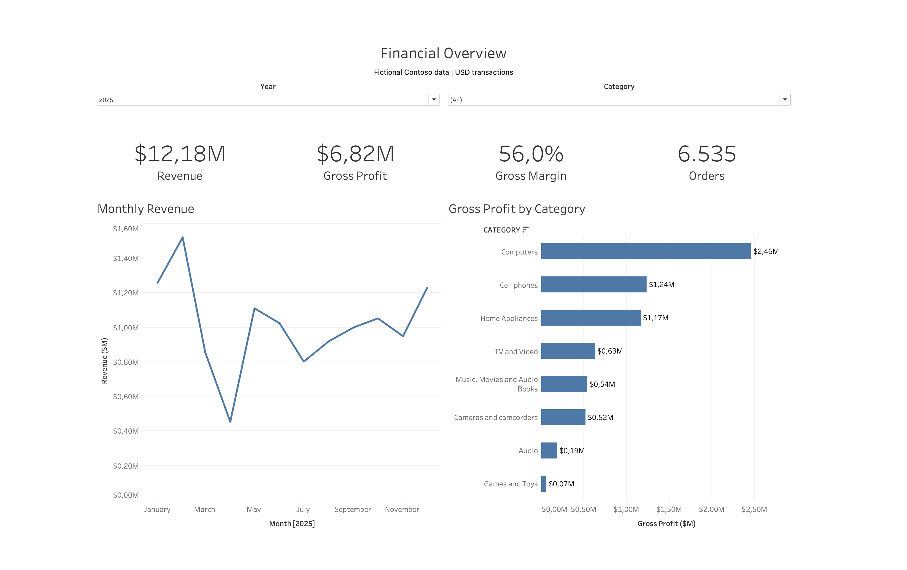
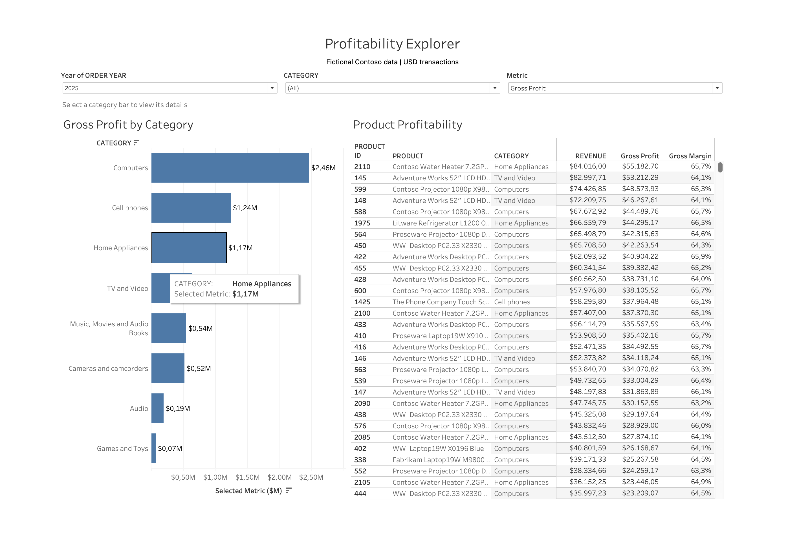
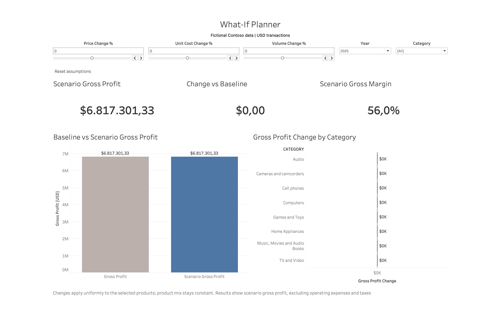

# Retail Profitability & What-If Planning

I built this project to explore retail gross profit and test how changes in price, unit cost and sales volume affect the result.

[Interactive dashboard](https://public.tableau.com/views/Retail_Profitability/1FinancialOverview?:language=en-GB&:sid=&:redirect=auth&:display_count=n&:origin=viz_share_link)
| [Portfolio website](https://dekeu.github.io/retail-profitability-self-build/)

## Dashboards

### Financial Overview
Revenue, gross profit, gross margin, orders and monthly sales.



### Profitability Explorer
Category comparisons and product details, with a selectable metric.



### What-If Planner
Price, unit-cost and volume controls, with baseline comparisons and a reset control.



## Data and definitions

The source is SQLBI's fictional Contoso dataset.
The analysis uses USD transactions only, with no FX conversion. One analytical row represents one sales order line.

- Revenue = quantity × historical net unit price.
- COGS = quantity × historical unit cost.
- Gross profit = revenue − COGS.
- Gross margin = total gross profit ÷ total revenue.
- Orders = distinct order IDs.

## Checked example

For the 2025 USD selection, baseline gross profit is $6,817,301.33. A 5% price increase, with unit cost and volume unchanged, produces $7,426,113.85 in scenario gross profit: an increase of $608,812.52.

This is a conditional scenario, not an observed business improvement.

Detailed findings and validation records are in analysis/.

## Reproducing the project

To explore the finished project, open the interactive dashboard or
download [the packaged Tableau workbook](dashboard/Retail_Profitability.twbx).

The processed CSV is documented in
[data/processed/README.md](data/processed/README.md).

### Rebuild from the source data

Requirements: DuckDB CLI and the original Contoso CSV files.

1. Download `csv-100k.7z` from the source release linked in
   [the raw-data notes](data/raw/README.md).
2. Extract the archive and place `sales.csv`, `product.csv` and
   `store.csv` inside `data/raw/`.
3. Open a terminal in the repository's root folder.

Create the output folder and open DuckDB:

```bash
mkdir -p data/processed
duckdb data/retail.duckdb
```

At the DuckDB prompt, run:

```text
.bail on
.read sql/01_load_raw.sql
.read sql/02_stage_sales.sql
.read sql/03_stage_dimensions.sql
.read sql/04_quality_checks.sql
.read sql/05_build_mart.sql
.read sql/06_answer_questions.sql
.read sql/07_export.sql
.read sql/08_extra_analysis.sql
.quit
```

The quality checks should report zero issues. The export checks should
confirm that the CSV's rows and financial amounts match the USD mart.

The final analysis script displays pricing scenarios, the break-even
volume decline and Computers product concentration.

Connect Tableau to `data/processed/retail_sales_usd.csv`.

## Limitations

The data is fictional. Gross profit excludes operating expenses and taxes. Scenarios apply uniform changes, keep product mix constant and do not estimate customer demand response.

## Tools

DuckDB, SQL, Tableau Public, VS Code, GitHub and GitHub Pages.

[Original dataset](https://github.com/sql-bi/Contoso-Data-Generator-V2-Data)